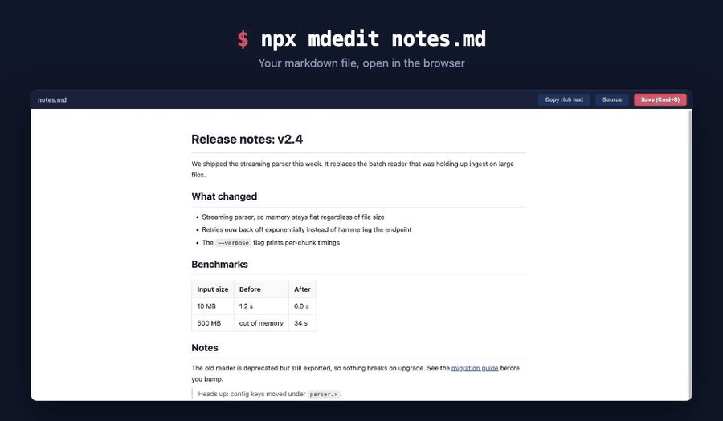

# editdown

Edit a markdown file in your browser and save it straight back to disk.

```sh
npx editdown notes.md
```



Every other `md*` CLI on npm renders markdown one way: disk to browser. `editdown` goes
both ways. You get a rich-text editor over your actual file, and Cmd+S writes it back
as markdown.

## Features

- **WYSIWYG editing** over the real file, with a one-click toggle to raw source.
- **Cmd+S saves to disk.** Writes are atomic, so an interrupted save cannot truncate
  your document.
- **Picks up outside edits.** Change the file in your editor and the browser reloads it,
  keeping your scroll position. Never while you have unsaved changes.
- **Link tooltips.** Hover a link to see its URL, right-click to pin, then edit or
  unlink it in place. Paste a URL over selected text to link it.
- **Copy rich text** for pasting into Google Docs, Word, or an email client, with code
  blocks and lists surviving the trip.
- **Images render inline**, resolved relative to the markdown file.
- **Offline and local.** Binds to `127.0.0.1`, no CDN, no telemetry, two dependencies.
- **Light and dark.** Follows the system appearance. The Theme button pins Light, Dark, or Auto, and that choice stays in this browser.

## Usage

```sh
editdown                    # edits README.md in the current directory
editdown docs/notes.md      # edits a specific file
editdown notes.md -p 3000   # pick the port (default 8432)
editdown notes.md --no-open # do not open a browser
```

If the port is taken, editdown walks up to the next free one.

| Shortcut | Action |
|---|---|
| `Cmd/Ctrl+S` | Save |
| `Cmd/Ctrl+B` | Bold |
| Right-click a link | Pin its tooltip |
| Paste a URL over a selection | Turn the selection into a link |

## Install

Nothing to install, `npx editdown` is the intended way to run it. If you want it always
on hand:

```sh
npm install -g editdown
```

Requires Node 18+.

## Notes

The file must already exist. `editdown` edits documents, it does not create them, so a
typo in the filename gets you an error rather than a stray empty file.

Round-tripping runs your document through HTML and back, which normalizes formatting:
list markers become `-`, headings become ATX (`##`), emphasis becomes `*`. The content
is preserved, the exact byte-level formatting of untouched sections may not be. Keep
your file in git, as you would anyway.

## License

MIT
